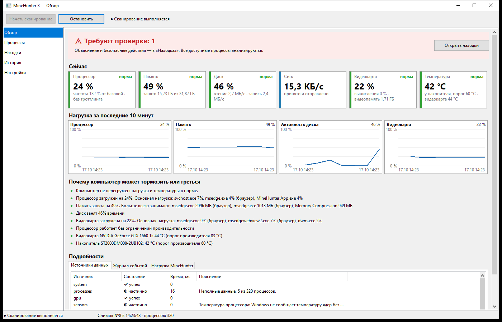

# MineHunter X

Библиотека и настольное приложение для Windows 10/11 x64, которые помогают понять,
почему компьютер тормозит, греется или ведёт себя необычно: скрытый майнинг,
подозрительные процессы, механизмы закрепления — и невредоносные причины нагрузки.

> MineHunter X оценивает поведение программ и даёт «степень подозрения» с объяснением,
> а не диагноз. Отсутствие находок не гарантирует отсутствие угроз.



## Быстрый старт (для пользователя)

1. Откройте раздел **Releases** этого репозитория и скачайте установщик
   `MineHunterX-<версия>-setup.exe` (или архив `MineHunterX-<версия>.zip` — переносная версия).
2. Установщик ставит программу для текущего пользователя без прав администратора (для всех
   пользователей — по выбору), создаёт ярлык и по желанию включает запуск вместе с Windows.
   Переносную версию достаточно распаковать и запустить `MineHunter.App.exe`.
   Если выпуск не подписан цифровой подписью, Windows SmartScreen может показать
   предупреждение: «Подробнее» → «Выполнить в любом случае».
3. Права администратора не обязательны. С ними программа видит все системные процессы
   (правый клик → «Запуск от имени администратора»).
4. Смотрите страницу «Обзор»: плашка сверху — есть ли что проверить, карточки «Сейчас» —
   текущая нагрузка и температура, ниже — почему компьютер может тормозить или греться.
5. Если есть находки — откройте «Находки»: там объяснение и безопасные действия.
   Программа ничего не удаляет и не останавливает без вашего подтверждения.

Требования: Windows 10/11 x64. Интернет не нужен — анализ полностью локальный (проверка
новых версий на GitHub выключена по умолчанию и включается только вами).
Данные программы: `%LOCALAPPDATA%\MineHunterX` (история, настройки, карантин; при удалении
программы сохраняются — удалите папку вручную, если они не нужны). Папку можно открыть или
перенести на другой диск: «Настройки → История наблюдений». Подробнее — раздел «Как
пользоваться» ниже.

## BinaryLab — глубокий разбор файлов (готовится к выпуску)

- Новая страница **BinaryLab** (`Ctrl+8`) и пункт «Открыть в BinaryLab» в меню «Процессов»,
  «Запусков» и «Что изменилось»: разбор любого файла **без запуска** — вид по содержимому,
  структура PE32/PE32+ (заголовки, секции, импорт, экспорт, ресурсы, TLS, подпись, оверлей),
  карта энтропии, Hex Viewer с подсветкой структур и поиском, строки-индикаторы (пулы, кошельки,
  команды, пути, реестр), вложенные программы и архивы, аномалии с объяснениями, сравнение двух
  файлов (BinaryDiff), отчёты HTML и JSON.
- Признаки из разбора файла передаются анализатору угроз: находка процесса этого файла получает
  их при следующей проверке (с пометкой «разбор файла в BinaryLab»).
- Тесты: [матрица «требование и функция → тесты»](docs/binarylab-tests.md) (`python tools/binarylab_test_matrix.py`).

## Что нового в 0.3.5

- **Меньше записи на диск:** история наблюдений и находки пишутся в базу пакетом раз в минуту,
  а не каждым снимком. Запись самой программы на диск снизилась примерно со 130 до 10 КБ/с.
  Перед открытием истории, журнала запусков и находок, а также при закрытии программы накопленное
  записывается сразу, поэтому данные на экране не запаздывают.

## Что нового в 0.3.4

- **Частота обновления** в «Настройках»: экономный режим, датчики видеокарт, разделы, журнал NVMe,
  диски и SMART, таблица «Запуски» — свой интервал или «выкл.» (значение читается при запуске и по
  «Проверить сейчас»); у основного опроса больше вариантов — от 1 с до 1 мин.

## Что нового в 0.3.3

- **Видеокарты**: выделенная и общая память — отдельными столбцами, как в диспетчере задач. У
  встроенной графики (Intel UHD и др.) больше не «0 КБ»: своей памяти у неё нет, видна общая.

## Что нового в 0.3.2

- **Устройства**: полоса прокрутки страницы больше не появляется и не исчезает каждые
  несколько секунд, когда окно развёрнуто на весь экран; таблицы не меняют высоту от числа строк.

## Что нового в 0.3.1

- **Журнал запусков**: параметры запуска (командная строка) и поиск по ним; выделенная строка
  и просматриваемая часть таблицы остаются на месте при обновлении.
- **Действия с файлом** в «Запусках», «Процессах» и «Что изменилось»: подробности с полным путём
  и параметрами, «Открыть папку и выделить файл», «Проверить на VirusTotal» (только отпечаток
  SHA-256, файл не отправляется), копирование.
- **Диски**: атрибуты здоровья как в CrystalDiskInfo — журнал NVMe (без прав администратора) и
  SMART дисков SATA; находка о нестабильных и переназначенных секторах (из-за них компьютер
  подвисает) и о критическом состоянии NVMe; описание проверки файлов на всех дисках.
- **Сеть**: скорость в битах в секунду, как в диспетчере задач; приём и передача — двумя линиями.
- **Графики**: без разрывов, когда окно свёрнуто или Windows притормаживает программу; «последние
  10 минут» — ровно по времени; выбранный диск, адаптер или видеокарта не сбрасываются на «Всего».
- **История**: страница прокручивается целиком, таблицы показываются полностью; прогресс профиля
  нормы — сколько снимков накоплено сейчас.
- **Настройки**: папка данных (открыть, перенести на другой диск, вернуть по умолчанию);
  «Проверенные находки» — сразу после «Разрешённых программ».

## Для разработчика — коротко

```powershell
git clone <адрес этого репозитория>
cd MineHunter
powershell -ExecutionPolicy Bypass -File tools\build.ps1 -Config Release   # нужна Delphi 12 (RAD Studio 23.0)
powershell -ExecutionPolicy Bypass -File tools\test.ps1  -Config Release   # 991 тест DUnitX
build\Win64\Release\MineHunter.App.exe
```

Подробности — разделы «Требования для сборки», «Сборка и тесты», «Структура», а также
[архитектура](docs/architecture.md) и [публичный API библиотеки](docs/api.md).

## Возможности

- **Процессы** — PID и время создания (защита от повторного PID), родитель, путь, SHA-256,
  цифровая подпись (встроенная и каталожная, без обращений к сети), CPU/память, потоки,
  командная строка нагруженных процессов, сетевые соединения, автозапуск.
- **Ресурсы** — как в диспетчере задач Windows: загруженность CPU с учётом частоты, память
  процессов (частный рабочий набор), самый загруженный диск, сеть; живые графики и история
  за 1 ч – 7 дней.
- **Видеокарта** — загрузка по процессам, отдельно вычислительные блоки (Compute, CUDA), на
  которых работают GPU-майнеры, видеопамять, температура (D3DKMT, для NVIDIA — NVML).
- **Перегрев и троттлинг** — температура видеокарты и накопителей с порогами производителя,
  ограничение производительности процессора; процессор — через LibreHardwareMonitor, если он
  запущен. Всё это входит в объяснение «почему компьютер тормозит или греется».
- **Автозапуск** — реестр Run/RunOnce (в т.ч. политики), папки автозагрузки, службы,
  планировщик заданий.
- **Сеть** — TCP/UDP (IPv4/IPv6) с привязкой к процессу; выводов по одному адресу не делается.
- **Анализатор угроз** — длительная фоновая нагрузка, признаки майнеров (имя, параметры, порты
  пулов), маскировка под системные процессы, подозрительные расположения, подпись, автозапуск,
  сценарии и скрытые команды, снижение нагрузки при запуске диспетчера задач, отклонение от
  нормы, фоновые вычисления на видеокарте. Оправдывающие факторы: доверенная подпись, работа
  пользователя, игры, компиляция, рендеринг, обновления, антивирус, добровольные научные
  вычисления (BOINC, Folding@home), обычная для компьютера нагрузка.
- **Профиль нормы** — отдельно для простоя, работы и игр (медианы, p95); сравнение периода
  с нормой и список программ, вышедших за её пределы.
- **Находки** — оценка 0–100, уровень, уверенность, признаки «за» и «против», недостающие
  данные, рекомендации, версия правил; история и экспорт отчёта и карточки в HTML/JSON.
- **Безопасные действия** — открыть расположение, проверить в Microsoft Defender (только отчёт),
  остановить процесс (с подтверждением и проверкой идентичности), «это моя программа»
  (исключение, привязанное к SHA-256). Все действия записываются в журнал.
- **Признаки вмешательства в защиту** — подписки WMI, исключения Microsoft Defender (в том числе
  через политики), перехват запуска (IFEO Debugger, SilentProcessExit), перенаправления в hosts,
  политики, отключающие диспетчер задач, реестр и защиту. Учитываются признаки рядом (драйвер
  WinRing0, скрытые файлы в ProgramData) и то, управляется ли компьютер организацией.
- **Исправление с откатом** — кнопка «Исправить…» в карточке находки показывает план (остановить
  процесс, отключить автозапуск, службу, задание, значения реестра, переместить файлы в
  карантин) и выполняет его только после подтверждения. Ничего не удаляется: всё можно
  вернуть в «Настройки → Карантин». Файлы Windows и критические службы не затрагиваются.
- **Работа в фоне** — значок в области уведомлений, уведомления о новых тревогах (без
  повторов), запуск вместе с Windows (по желанию), экономный режим опроса, пока окно скрыто.
- **«Проверить сейчас»** — внеочередная полная проверка и отчёт простым языком: тревоги с
  причинами, почему тормозит или греется, что изменилось за неделю, расход электроэнергии,
  ограничения проверки.
- **«Что изменилось»** — новые записи автозапуска, признаки вмешательства и впервые
  запущенные программы за 7 дней (исходное состояние компьютера изменением не считается).
- **Электроэнергия** — мощность видеокарты (датчик NVIDIA через NVML) и стоимость по вашей
  цене за кВт·ч: сейчас, за период и в пересчёте на месяц.
- **Запуски процессов (ETW)** — с правами администратора программа видит каждый запуск и
  завершение процесса, включая те, что живут меньше интервала опроса, и замечает программы,
  которые раз за разом запускаются и сразу завершаются (загрузчики и «сторожа» майнеров).
- **Журнал запусков** — какая программа, когда запускалась, с какими параметрами, кто её запустил
  и сколько работала, за час – 30 дней, с поиском (в том числе по параметрам). С правами
  администратора — через ETW (каждый запуск), без них — по изменениям списка процессов между
  опросами (короткоживущие процессы могут не попасть).
- **Действия с файлом** в «Запусках», «Процессах» и «Что изменилось» (правая кнопка мыши или двойной
  щелчок): подробности с полным путём и параметрами, «Открыть папку и выделить файл», «Проверить на
  VirusTotal» (в браузере — отчёт по SHA-256; файл не отправляется), копирование пути и параметров.
- **«Проверено, не беспокоить»** — для любой находки, в том числе реестра, политик и исключений
  Defender: отметка запоминает содержимое находки, и тревога вернётся, если там появится что-то
  новое или риск вырастет. Отметки можно снять в «Настройки → Проверенные находки».
- **Устройства: диски** — каждый физический диск отдельно (тип, шина, разделы, занятость, чтение и запись,
  температура с порогом, состояние по оценке Windows с учётом SMART, износ SSD, ошибки, наработка),
  свободное место на каждом разделе с предупреждением, программы с наибольшим чтением и записью.
  Атрибуты здоровья выбранного диска — те же, что в CrystalDiskInfo: журнал здоровья NVMe (наработка,
  включения, аварийные отключения, объём чтения и записи, ошибки носителя — без прав администратора)
  и SMART дисков SATA (с правами администратора).
  Находки: почти заполненный раздел, неисправный диск, исчерпанный ресурс SSD, ошибки чтения,
  нестабильные и переназначенные секторы (из-за них компьютер подвисает при обращении к диску),
  критическое предупреждение NVMe.
- **Устройства: сеть и видеокарты** — каждый сетевой адаптер (тип, подключение, скорость канала,
  приём и передача в битах в секунду, как в диспетчере задач, на графике — двумя линиями) и каждая
  видеокарта (загрузка, вычисления, выделенная и общая память — как в диспетчере задач, температура,
  мощность) отдельно и строкой «Всего»;
  для любого диска, адаптера, видеокарты и итога — график за 10 минут.
- **Проверка файлов на всех дисках** — по кнопке или раз в неделю в простое: известные майнеры,
  конфигурации пулов, сценарии запуска, драйвер WinRing0 и соседние с ним программы, скрытые
  системные exe вне папок программ, маскировка под системные файлы, строки майнера внутри программ
  из нетипичных мест. Низкий приоритет ввода-вывода, отмена, карантин и «это мой файл» из результатов.
- **BinaryLab** — разбор файла без запуска и без изменения: вид по содержимому (EXE, DLL, SYS,
  архивы, документы, сценарии; несоответствие расширения), PE Analyzer, энтропия по блокам с
  интерактивной картой, Hex Viewer, строки-индикаторы, вложенные файлы, аномалии структуры PE,
  BinaryDiff, отчёты HTML/JSON. Анализ в фоне с отменой, память ограничена лимитами, повреждённые
  файлы разбираются без сбоев. Результат дополняет находку процесса этого файла.
- **Интерфейс** — русский и английский язык (включая объяснения находок и отчёты), светлая и
  тёмная тема, экспорт и импорт настроек. Таблицы не прыгают при обновлении (выделение и
  просматриваемая часть остаются на месте), страницы «Обзор», «Устройства», «История» и
  «Настройки» прокручиваются колесом целиком, небольшие таблицы показываются полностью.
- **Приватность** — всё локально; история, настройки и карантин — в папке данных
  (по умолчанию `%LOCALAPPDATA%\MineHunterX`; «Настройки → История наблюдений»: открыть папку или
  перенести её, например, на другой диск); отчёты по умолчанию обезличены.

## Как пользоваться

1. Запустите `MineHunter.App.exe` (права администратора не обязательны; без них часть
   системных процессов видна частично — программа сообщает об этом).
2. **Обзор** — сверху цветная плашка: есть ли что проверить. Ниже карточки «Сейчас»
   (процессор, память, диск, сеть, видеокарта, температура) с отметкой «норма / внимание /
   высокая», графики за 10 минут и список «почему компьютер может тормозить или греться» —
   первая строка даёт итог. Технические подробности (источники данных, журнал, нагрузка
   самого MineHunter) — во вкладках внизу.
3. **Находки** — выберите строку, прочитайте объяснение. Если это ваша программа (рендеринг,
   майнинг по вашему желанию и т.п.) — «Это моя программа». Если нет — «Проверить в Defender»
   и «Открыть расположение»; «Исправить…» покажет план и выполнит его после подтверждения
   (с возможностью отката в «Настройки → Карантин»). Остановка процесса всегда требует
   подтверждения.
4. **Процессы** — сортировка по CPU, памяти, риску, подписи; фильтры «только с находками»,
   «только без подписи».
5. **Устройства** — вкладки «Диски», «Сеть», «Видеокарты»: каждое устройство и «Всего», график
   выбранной строки; на «Дисках» — разделы, свободное место, кто больше всего читает и пишет, и
   кнопка «Проверить файлы на всех дисках» (майнеры и их следы там, где они сейчас не запущены).
6. **Запуски** — журнал запусков программ за выбранный период с поиском по имени, пути, параметрам
   и родителю. Двойной щелчок или правая кнопка мыши — подробности, папка с файлом, VirusTotal
   (так же в «Процессах» и в «Что изменилось» на «Истории»).
7. **BinaryLab** — «Открыть файл…» или «Открыть в BinaryLab» из меню таблиц. Вкладки: «Обзор» (итог и
   аномалии с объяснениями), «Структура», «Карта» (щелчок по карте открывает место в Hex), «Hex»
   (переход к смещению, поиск текста и байтов), «Строки», «Вложения», «Сравнение» (второй файл,
   например оригинал той же версии). «Экспорт отчёта…» — HTML или JSON. Файл не запускается и не
   изменяется; оценка — повод для проверки, а не диагноз.
8. **История** — графики за период, электроэнергия видеокарты, «что изменилось за 7 дней» и
   сравнение с нормой (профиль формируется за 3 дня работы).
9. **Настройки** — интервал опроса, частота обновления (экономный режим, датчики видеокарт, разделы,
   журнал NVMe, диски и SMART, таблица «Запуски»; любой пункт можно выключить — тогда значение
   читается при запуске и по «Проверить сейчас»), срок хранения и папка данных, пороги анализа, исключения,
   проверенные находки, журнал действий, карантин, работа в фоне и уведомления, цена электроэнергии, язык,
   тема, проверка обновлений, экспорт и импорт настроек.
10. **«Проверить сейчас»** (кнопка вверху) — полная проверка и отчёт, который можно сохранить.

Крестик окна убирает программу в область уведомлений (если это включено в настройках);
выход — «Выход» в меню значка. Клавиши: `F5` — начать сканирование, `Shift+F5` — остановить,
`Ctrl+1…7` — разделы (`Ctrl+4` — «Устройства», `Ctrl+5` — «Запуски»), `Ctrl+8` — BinaryLab.

## Проверенные результаты (17.10.2026, Windows 10 Pro x64, 20 логических CPU)

| Критерий ТЗ | Требование | Результат |
|---|---|---|
| Автотесты (DUnitX, Debug и Release) | 100% | 991 из 991, утечек 0 |
| Синтетические сценарии угроз | 100% обнаружение | 12 из 12, включая майнер на видеокарте и вмешательство в защиту ([отчёт](docs/false-positive-report.md)) |
| Ложные срабатывания на легальной нагрузке | отдельный отчёт | 0 из 22 (игры, компиляция, рендеринг на CPU и GPU, Folding@home, трансляция, обновления, антивирус, исключения разработчика…) |
| Нагрузка в простое | ≤ 2% CPU | 0,16% CPU машины ([GUI-soak](docs/gui-soak-report.md)); с видеокартой и датчиками — 0,21% ([отчёт](docs/gui-soak-gpu-report.md)) |
| Память | ≤ 200 МБ | ~48 МБ в работе, пик ~58 МБ; версия 0.2.0 (ETW, трей, тёмная тема) — ~62 МБ, 0,22% CPU в установившемся режиме ([отчёт](docs/gui-soak-0.2.0-report.md)) |
| Отклик интерфейса | без зависаний | 150 проверок за 75 мин, 0 зависаний, штатное закрытие |
| 8 ч без сбоев | 0 необработанных исключений | 14 402 цикла (8 ч при опросе 2 с), 0 ошибок ([soak](docs/soak-report.md)); с видеокартой и датчиками — 14 495 циклов, 0 ошибок ([отчёт](docs/soak-gpu-report.md)) |
| Нет утечек при перестройке нормы | — | 11 перестроек за 58 мин: рост памяти после прогрева 1,9 МБ ([отчёт](docs/soak-rebuilds-report.md)) |
| Отказ источника | остальные работают | изоляция коллекторов с повтором; покрыто тестами |

Ограничения — в [docs/limitations.md](docs/limitations.md) (температура CPU без драйвера, ETW без прав
администратора, мощность только у NVIDIA и др.).

## Структура

| Путь | Назначение |
|---|---|
| `src/Core` | Модели, публичный API, DI, сканер, анализатор, норма, настройки, отчёты, действия |
| `src/Core/Collectors` | Коллекторы данных (`IMHCollector`) |
| `src/Core/BinaryLab` | BinaryLab: разбор файлов без запуска (PE, энтропия, строки, вложения, аномалии, BinaryDiff, отчёты) |
| `src/Storage` | История в SQLite (FireDAC, статически встроенный SQLite) |
| `src/App` | VCL-приложение (composition root, формы, модели представления, график) |
| `tests/Unit`, `tests/Integration`, `tests/UI`, `tests/Fixtures` | DUnitX-тесты, безвредные двойники и сценарии |
| `tests/Fixtures/regression` | Обезличенные снимки для регрессии оценок риска |
| `tests/Soak` | Длительный (soak) тест |
| `tools` | Сборка, тесты, GUI-soak, установщик, подпись, служебные скрипты |
| `installer` | Сценарий установщика Inno Setup 6 |
| `docs` | [Архитектура](docs/architecture.md), [API](docs/api.md), [модель угроз](docs/threat-model.md), [ограничения](docs/limitations.md), [ложные срабатывания](docs/false-positive-report.md) |
| `build` | Артефакты сборки (не хранятся в репозитории) |

## Требования для сборки

- RAD Studio / Delphi 12 Athens (Studio 23.0), платформа Win64; DUnitX и FireDAC из поставки.
- Python 3 — только для служебных скриптов `tools/*.py` (генерация `.dproj`, экранирование DFM).
- Для установщика — Inno Setup 6; для подписи — `signtool` из Windows SDK и сертификат
  подписи кода.

## Сборка и тесты

```powershell
powershell -ExecutionPolicy Bypass -File tools\build.ps1 -Config Release
powershell -ExecutionPolicy Bypass -File tools\test.ps1  -Config Release
# без UI-тестов (агент без интерактивного рабочего стола):
powershell -ExecutionPolicy Bypass -File tools\test.ps1  -Config Release -Exclude UI
# длительные проверки:
build\Win64\Release\MineHunter.Soak.exe                 # 14 400 циклов = 8 ч при интервале 2 с
build\Win64\Release\MineHunter.Soak.exe --rebuild-every=5   # плюс перестройка нормы каждые 5 мин
powershell -ExecutionPolicy Bypass -File tools\gui-soak.ps1 -Minutes 60
```

Установщик и подпись:

```powershell
powershell -ExecutionPolicy Bypass -File tools\make-installer.ps1            # dist\MineHunterX-<версия>-setup.exe
powershell -ExecutionPolicy Bypass -File tools\make-installer.ps1 -Sign -Thumbprint <отпечаток>
powershell -ExecutionPolicy Bypass -File tools\sign.ps1 -Files <exe> -PfxPath <файл.pfx>   # пароль — MH_SIGN_PFX_PASSWORD
```

Сценарии автоматизации закрывают программу сообщением `MineHunterX.Quit`
(`RegisterWindowMessage`): `WM_CLOSE` при включённом трее только скрывает окно.

Если RAD Studio установлена не в стандартный каталог, передайте `-BdsDir` или задайте `BDS`.
Результаты: `build\Win64\<Config>\MineHunter.App.exe`, отчёт тестов —
`build\test-results\MineHunter.Tests.<Config>.xml` (NUnit), отчёт о ложных срабатываниях —
`build\Win64\<Config>\reports\false-positive-report.md`.

Категории тестов: `Unit`, `Contract`, `Integration`, `Storage`, `Threading`, `Leaks`,
`Performance`, `Regression`, `UI`.

## Соглашения

- Исходники `.pas`/`.dpr` — UTF-8 с BOM (иначе компилятор читает их в ANSI).
- Строки с кириллицей в `.dfm` хранятся escape-последовательностями `#NNNN`;
  после ручной правки DFM выполните `python tools/dfm_escape.py <файл.dfm>`.
- Список модулей проекта задаётся в `.dpr`; после его изменения выполните
  `python tools/gen_dproj.py`.
- Тёмная тема — стиль VCL `Windows10 Dark` из поставки RAD Studio (`src/App/Styles`),
  встраивается ресурсом `MineHunter.App.Styles.rc`.

## Лицензия

MIT — см. [LICENSE](LICENSE).
